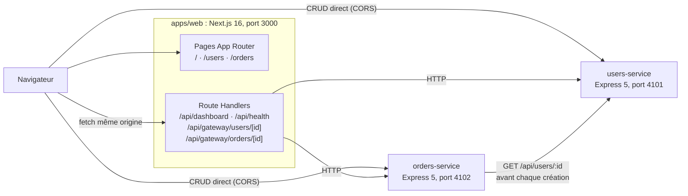

# Architecture de MicroShop

MicroShop est un petit back-office e-commerce composé d'une application Next.js et de deux
microservices Express. Il sert de banc d'essai à Auto-Doc : le code est volontairement court,
mais il utilise plusieurs façons de déclarer des routes.

## Vue d'ensemble



| Composant | Rôle | Stockage |
|---|---|---|
| `services/users-service` | CRUD des utilisateurs, statistiques | Tableau en mémoire (`src/data/users.data.ts`) |
| `services/orders-service` | CRUD des commandes ; vérifie l'utilisateur auprès de users-service | Tableau en mémoire (`src/data/orders.data.ts`) |
| `apps/web` | Interface (tableau de bord, utilisateurs, commandes) et passerelle d'agrégation | Aucun |

### Flux de communication

1. **Navigateur → microservices** : les pages Utilisateurs et Commandes appellent directement
   les API Express (`NEXT_PUBLIC_USERS_SERVICE_URL`, `NEXT_PUBLIC_ORDERS_SERVICE_URL`). Chaque
   service autorise l'origine du frontend via son middleware CORS (`WEB_ORIGIN`).
2. **Navigateur → passerelle** : le tableau de bord et les fiches détaillées passent par les
   Route Handlers Next.js, qui agrègent les deux services côté serveur.
3. **orders-service → users-service** : `POST /api/orders` appelle
   `GET {USERS_SERVICE_URL}/api/users/:id` (`src/services/users.client.ts`). Si l'utilisateur
   est inconnu ou inactif, la réponse est 422 ; si users-service est injoignable, 503.

## Structure d'un microservice Express

```text
src/
├── server.ts          # point d'entrée : charge ../../.env (optionnel) puis app.listen()
├── app.ts             # instance Express, middlewares globaux, montage des routeurs
├── types.ts           # types du domaine
├── errors.ts          # HttpError (status, code, message, details)
├── routes/            # déclaration des routes uniquement
├── controllers/       # lecture de la requête, écriture de la réponse
├── services/          # logique métier (et client HTTP inter-services)
├── middleware/        # CORS, validation, 404 et gestion des erreurs
└── data/              # jeu de données en mémoire + fonction de réinitialisation
```

La chaîne d'une requête : `app.ts` → routeur(s) → middlewares de validation → contrôleur →
service → données. Les erreurs (`HttpError`, JSON invalide, erreurs inattendues) sont converties
par `errorHandler` au format `{ "error": { "code", "message", "details?" } }`. Express 5 transmet
automatiquement au gestionnaire d'erreurs les promesses rejetées des handlers asynchrones.

## Constructions de routes volontairement variées

| Construction | Où |
|---|---|
| `app.get()` direct avec handler inline | users-service `src/app.ts` (`/health/users`) |
| `express.Router()` | users-service `routes/index.ts`, `routes/users.routes.ts` |
| `Router()` importé nommément | orders-service `routes/*.routes.ts` |
| Montage `app.use(prefix, router)` | `/api` et `/api/orders`, `/health` |
| Routeurs imbriqués | `apiRouter.use('/users', usersRouter)` ; `ordersRouter.use('/:id/status', orderStatusRouter)` avec `mergeParams` |
| Regroupement `router.route().get().patch().delete()` | users-service `/:id` ; orders-service `route('/')` et `route('/:id')` |
| Handlers importés depuis des contrôleurs | toutes les routes sauf `/health/users` |
| Middleware de paramètre `router.param()` | users-service (`validateUserIdParam`) |
| Fabrique de middleware | orders-service `validateIntegerParam('id' \| 'userId')` |
| Middlewares de validation | query (`validateListUsersQuery`, `validateListOrdersQuery`) et corps JSON |
| Middlewares d'erreurs | `notFoundHandler` et `errorHandler` (signature à 4 arguments) |
| Route Handlers Next.js et segment dynamique `[id]` | `apps/web/app/api/**/route.ts` |

Paramètres couverts : chemin (`:id`, `:userId`, `[id]`), requête (`search`, `role`, `status`,
`limit`) et corps JSON (création d'utilisateur, de commande, changement de statut).

## Données en mémoire

Aucune base de données : chaque service garde ses données dans un tableau en mémoire,
**réinitialisé à chaque démarrage**. users-service démarre avec 6 utilisateurs (dont 1 inactif),
orders-service avec 8 commandes qui référencent ces utilisateurs. Supprimer un utilisateur ne
supprime pas ses commandes : les services sont indépendants, et la passerelle renvoie alors
`user: null` pour la commande concernée.

## Configuration

Toutes les valeurs ont un défaut dans le code ; le fichier `.env` à la racine (copie de
`.env.example`) est facultatif et chargé par `server.ts` et `next.config.ts`.

| Variable | Défaut | Utilisée par |
|---|---|---|
| `USERS_SERVICE_PORT` | `4101` | users-service |
| `ORDERS_SERVICE_PORT` | `4102` | orders-service |
| `USERS_SERVICE_URL` | `http://localhost:4101` | orders-service, passerelle Next.js |
| `ORDERS_SERVICE_URL` | `http://localhost:4102` | passerelle Next.js |
| `NEXT_PUBLIC_USERS_SERVICE_URL` | `http://localhost:4101` | navigateur (intégrée au build) |
| `NEXT_PUBLIC_ORDERS_SERVICE_URL` | `http://localhost:4102` | navigateur (intégrée au build) |
| `WEB_ORIGIN` | `http://localhost:3000,http://127.0.0.1:3000` | CORS des deux services |

## Tests

| Fichier | Portée |
|---|---|
| `services/users-service/tests/users.api.test.ts` | Les 7 routes avec Supertest : filtres, 200/201/204/400/404/409, JSON invalide, CORS |
| `services/orders-service/tests/orders.api.test.ts` | Les 7 routes avec Supertest ; users-service simulé via `fetch` (404, inactif, 500, panne) |
| `apps/web/tests/gateway.routes.test.ts` | Les 4 Route Handlers appelés directement ; microservices simulés |
| `tests/integration/microservices.test.ts` | Les deux services démarrés sur `127.0.0.1` (ports éphémères) : orders → users et passerelle → services en HTTP réel, puis panne de users-service |
| `tests/route-inventory.test.ts` | Compare les routes enregistrées à l'exécution avec `docs/route-inventory.json` |

Aucun test n'appelle un service externe : les appels `fetch` sont soit simulés, soit limités à
`127.0.0.1` par un garde-fou qui fait échouer le test sinon.
